# Retro Mac

**A 1-bit vintage-Mac face for your AI agents.** One animated pixel face per agent. The faces talk with local voices and lip-sync, and the screen shows what your crew is working on. Tap Space to talk to them.

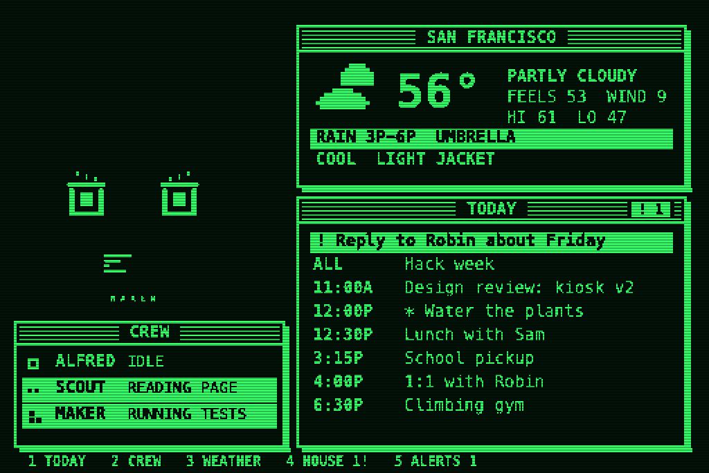

Retro Mac is a small always-on kiosk display for [Hermes Agent](https://github.com/NousResearch/hermes-agent), Nous Research's open-source agent. It renders a 512×342 screen, the resolution of the original Macintosh, scaled up crisply to any display. The display shows:

- a talking face for each agent (Alfred, Scout and Maker by default)
- a crew panel that shows what each agent is doing right now
- a glanceable dashboard with the weather, what to wear, today's agenda and reminders

Everything runs on your own machine. The server binds to `127.0.0.1` only. Speech is synthesized locally with Piper. The mic opens only when you tap Space (or, if you turn it on, when it hears the wake word).

You can try it in under two minutes without Hermes, Google or any API keys: `./start.sh --demo`.

| Dashboard | Click-in window | Faces | Themes |
|---|---|---|---|
| 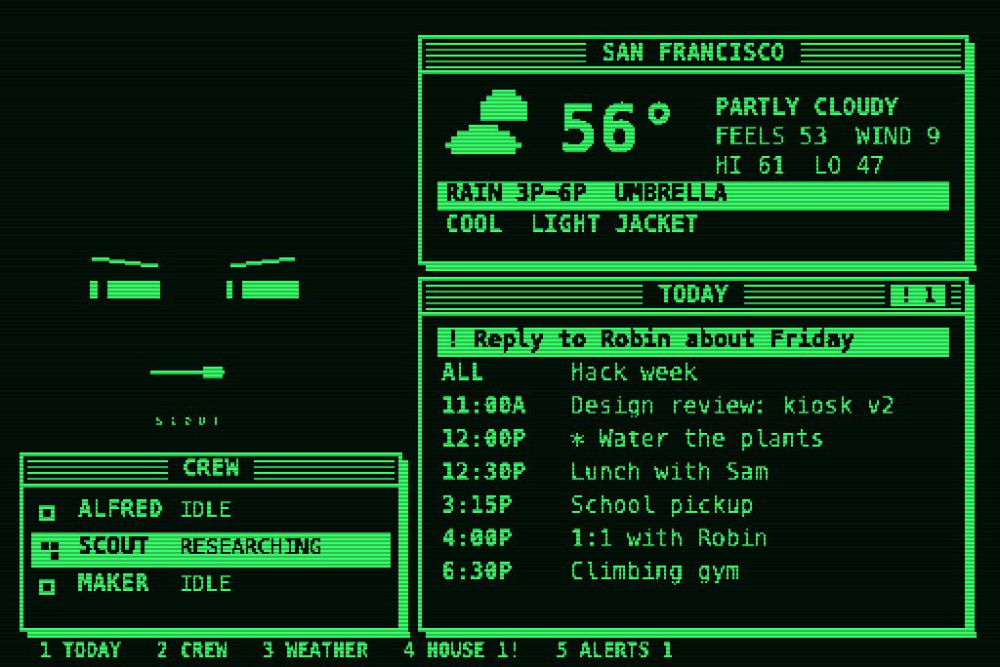 | 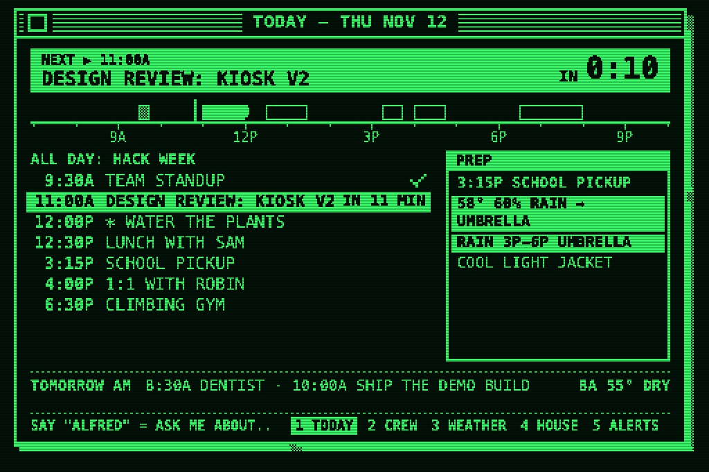 | 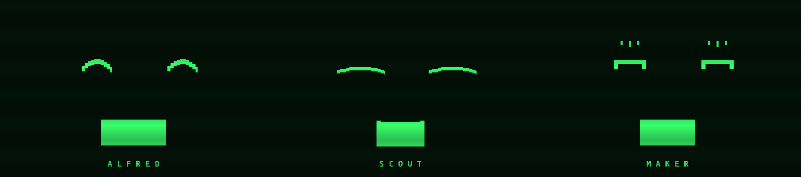 | 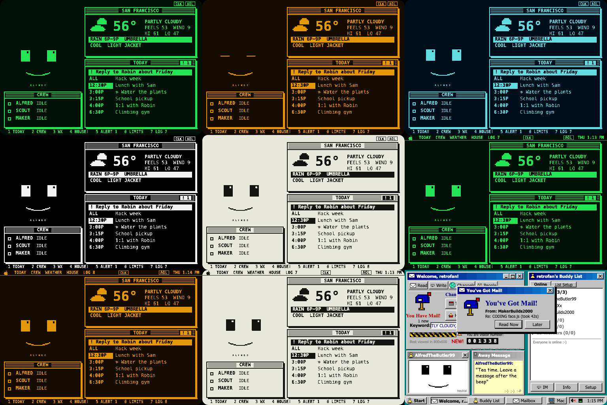 |

## Install it with your AI agent

The easiest way to set it up: paste this into Hermes Agent, Claude Code, Codex or any agent that can use your terminal.

> Install and set up Retro Mac for me by following https://github.com/gershee/retro-mac/blob/main/docs/AGENT-INSTALL.md. Keep everything local, show me the demo first, and ask me before installing system packages, editing my Hermes config, restarting my gateway or turning on the mic.

The [full prompt](docs/AGENT-INSTALL.md) walks the agent through the demo, your city and voices, the Hermes plugin, push-to-talk and auto-start, checking each step with you. Prefer doing it by hand? See [Quick start](#quick-start-demo-mode-about-2-minutes).

## Features

- **A pixel face for each agent.** Each agent has its own eyes, brows and mouth. The face blinks, glances around, yawns and dozes, and its mood follows the time of day: fresh in the morning, drowsy at night, asleep after 11 pm with floating z's. It reacts to activity with thinking, working, listening, surprised, happy and concerned expressions.
- **Local TTS with lip-sync.** Each agent has its own [Piper](https://github.com/rhasspy/piper) voice. Speech is streamed sentence by sentence, and a Web Audio analyser drives the mouth. Agents can add tone tags such as `[happy]` or `[concerned]` that bend the expression mid-sentence. If no voices are installed, the faces "beep-speak" and the lip-sync still works.
- **Push-to-talk.** Tap Space to talk and tap it again to send. Tapping Space while a face is speaking interrupts it. A status banner shows LISTENING → GOT IT → WORKING → SPEAKING, with a live checklist of the agent's tool steps narrated in plain English. An optional wake-word daemon ([sherpa-onnx](https://github.com/k2-fsa/sherpa-onnx) keyword spotting) is also included.
- **Crew activity panel.** It shows who is thinking, working or idle, and on what. It is fed live by Hermes plugin hooks. Only short verbs and file names are sent, never command text or file contents.
- **Dashboard.** Weather from [Open-Meteo](https://open-meteo.com) (free, no key) with "umbrella / light jacket" advice, today's agenda from any calendar command you plug in, Hermes cron reminders, and an attention list.
- **Classic-Mac click-in windows.** Press keys 1-7 or click a panel to zoom open TODAY, CREW, WEATHER, HOUSE (local service health), ALERTS, LIMITS (optional Claude plan usage) and LOG (the crew log). They use the 1984 zoom-rect animation. Press `?` for an About box with the day's tallies, and `M` for an optional classic menu bar.
- **Crew log (key 7).** A persistent journal of what the crew did today: finished jobs, first sentence of each spoken reply, failed or rate-limited turns and short voice questions. It survives restarts (`data/logs/crew-log-YYYY-MM-DD.jsonl`, kept 30 days, never committed). Demo mode shows invented sample entries.
- **Themes and skins.** Green, amber, cyan, mono and paper phosphor themes, plus a light/dark tone slider and scanlines. The last theme in the `T` cycle is an opt-in **AOL / Windows 98 skin**: sign-on and dial-up screen, buddy list driven by the real crew feed, spoken replies as Instant Messages, "You've Got Mail!" when a job finishes, and a taskbar with a Start menu. A tiny `AOL` tag (top right) and the Start menu switch to it and back, so it works by touch too. Everything is drawn in code, with no Microsoft or AOL assets.
- **Four clocks (key C).** Off by default. `C` (or the tiny `CLK` tag) cycles **flip** (split-flap cards), **cuckoo** (a crew member pops out of a cuckoo house on the hour), **screensaver** (after 10 quiet minutes the dashboard dissolves into stars and big bouncing digits) and **morph** (digits dissolve into the next ones). The choice persists.
- **Anti burn-in.** Built for an always-on LCD: a pixel orbit shifts the picture a few device pixels every couple of minutes, a night rest (11:30 PM to 6 AM, 20 quiet minutes) dims and shrinks the screen, and a **clearing mode** (`W`) cycles colours to help with retention that already exists. Any key, mouse move, speech or crew activity wakes it at once. `?noburn` turns the whole layer off.
- **Built for a kiosk.** It runs full-screen in Chrome, auto-starts with launchd, keeps the display awake, and includes a `doctor.sh` health check.

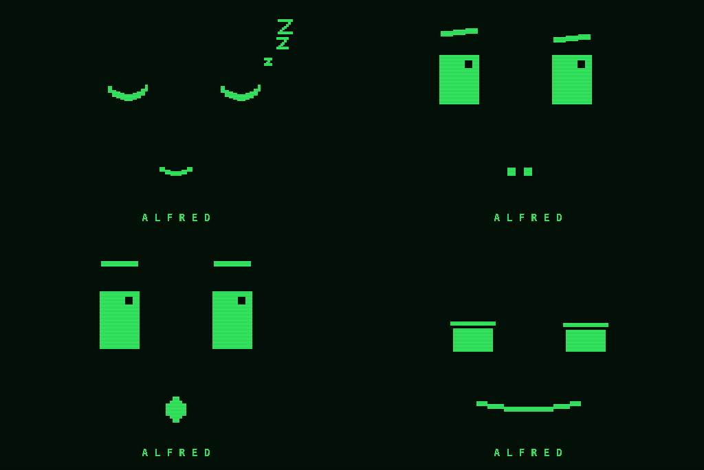

### Clocks (key C) and the AOL skin (key T)

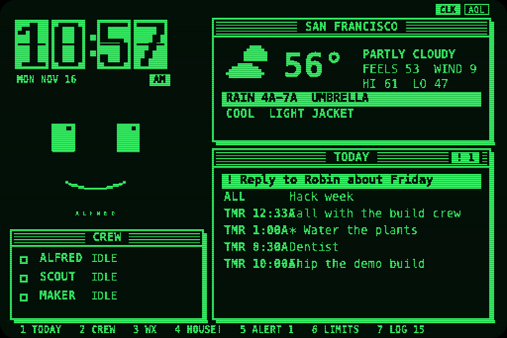

| Flip | Cuckoo (on the hour) | Screensaver | Morph |
|---|---|---|---|
| 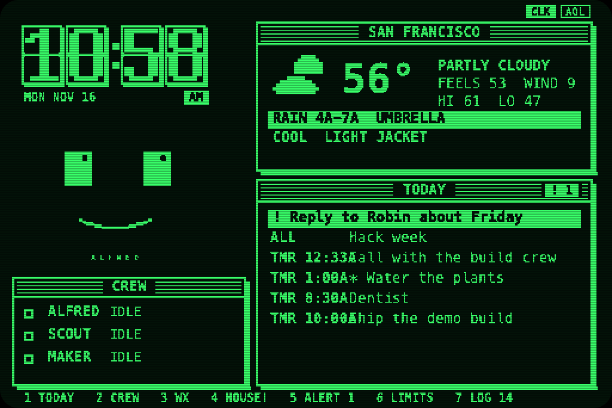 | 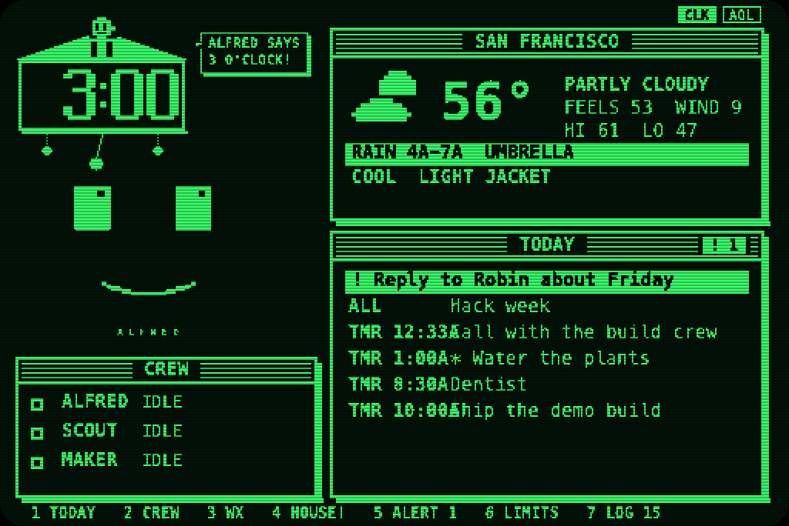 | 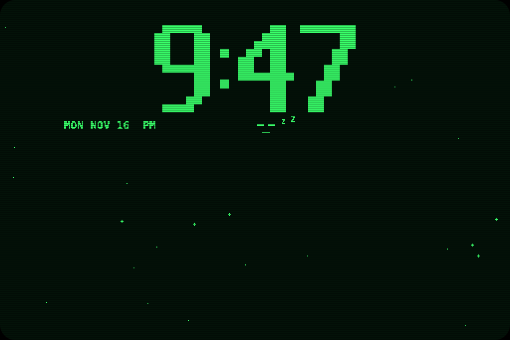 | 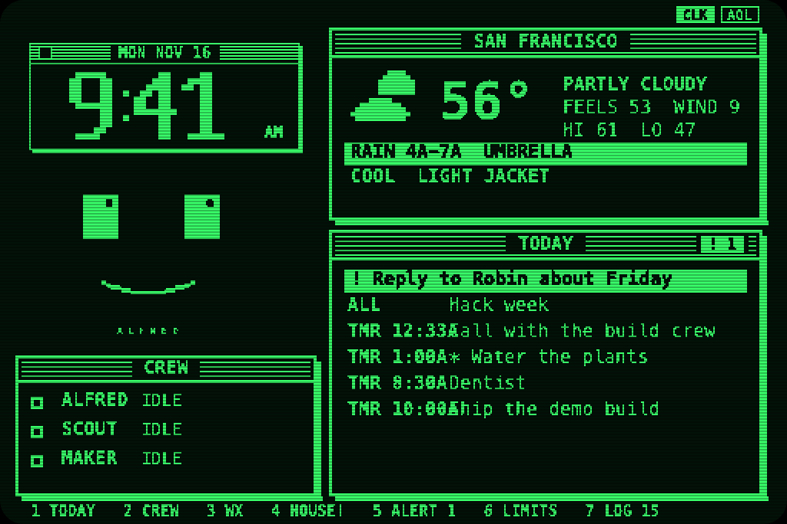 |

| Default look (green phosphor) | AOL / Windows 98 skin | Cuckoo close-up |
|---|---|---|
| 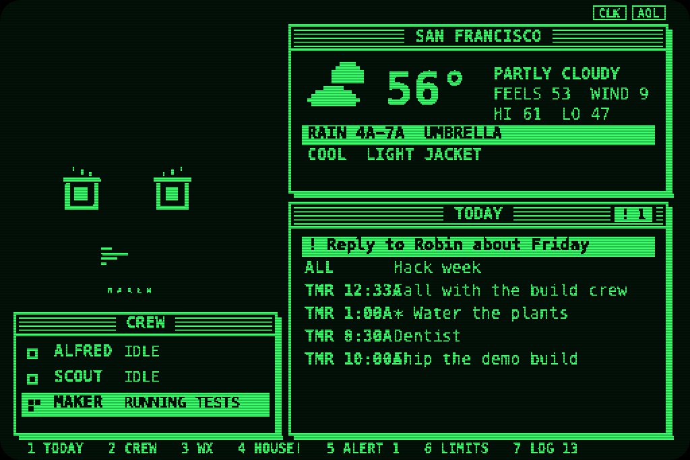 | 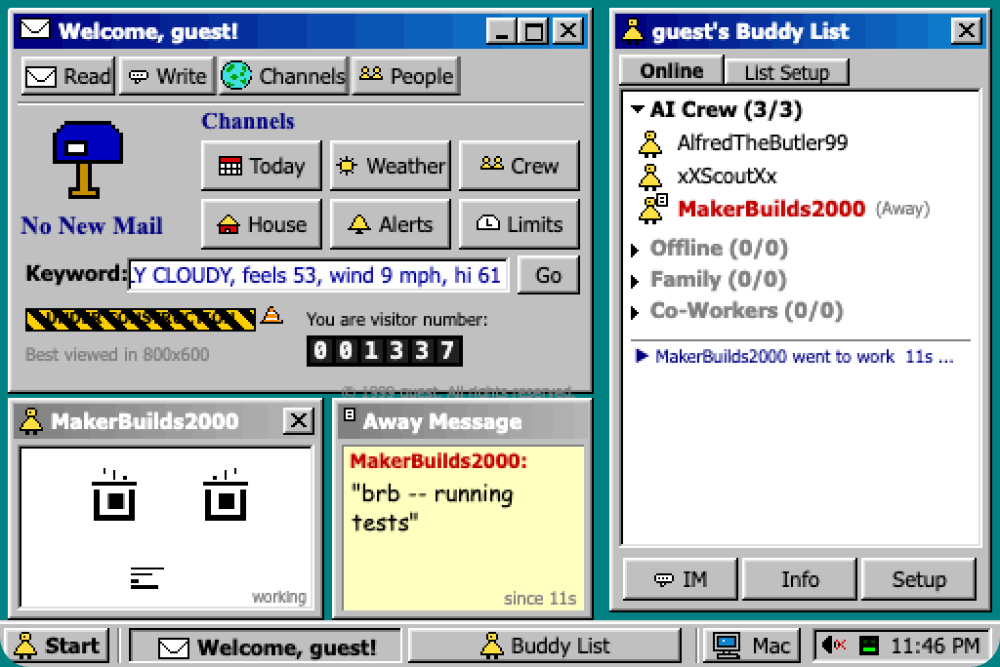 | 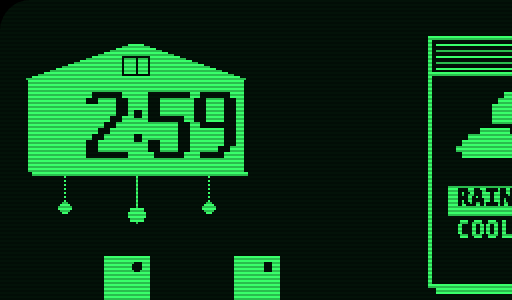 |

Screenshots and GIFs come from `./start.sh --demo` (invented weather, agenda and crew log; screen name `guest`).

## How it works

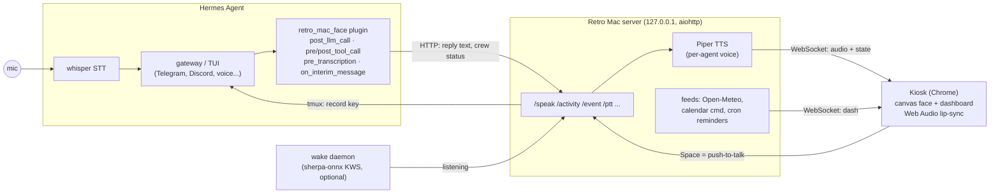

1. A Hermes agent finishes a reply. The `retro_mac_face` plugin's `post_llm_call` hook POSTs `{agent, text}` to the local server. This is fire-and-forget on a daemon thread, so it can never slow down or break chat delivery.
2. The server splits the reply into sentences, synthesizes them with that agent's Piper voice and streams them over a WebSocket. The kiosk plays them gaplessly and moves the mouth from the audio level.
3. `pre_llm_call` and the tool hooks send crew status ("Scout: researching", "Maker: running tests"), which drives the crew panel and the faces' working/thinking moods.
4. Voice: Space (or the wake word) arms the server. The server presses the record key in a `hermes --tui` voice session running in tmux. Hermes transcribes the speech (whisper) and runs the turn. Voice turns get short, spoken-style answer rules injected, and long jobs go to the background.

More detail: [ARCHITECTURE.md](ARCHITECTURE.md).

## Quick start (demo mode, about 2 minutes)

Requirements: Python 3.11+ and a browser. No Hermes, no keys, no calendar.

```bash
git clone https://github.com/gershee/retro-mac.git && cd retro-mac
python3 -m venv venv && venv/bin/pip install -r requirements.txt
./start.sh --demo
open http://127.0.0.1:8787/          # or visit it in any browser
```

Demo mode shows sample weather, agenda, reminders and alerts, plus a scripted crew loop. It never starts tmux or the mic. To make a face talk:

- open `http://127.0.0.1:8787/?test`, click once to unlock sound, then use the test buttons, or
- run `venv/bin/python scripts/demo-tour.py` for a scripted tour (this is what recorded the GIF above).

Out of the box the faces beep-speak: `requirements.txt` is just the web server (aiohttp, a few MB). For real voices, install Piper and fetch the voices, then restart the server:

```bash
venv/bin/pip install -r requirements-voice.txt    # Piper TTS + onnxruntime, about 300 MB
scripts/fetch-models.sh                           # the three voices, about 190 MB, SHA-256 checked
```

Preview URLs: `/?test&agent=scout&mood=sleep`, `/?test&hour=3&idle=120` (fake the clock), `/?test&wxage=60` (a stale weather reading shows "AS OF"), `/?theme=amber`, `/?tone=0`.

Use a different port: `RETRO_MAC_PORT=8797 ./start.sh --demo`. Stop the server with `kill $(lsof -tiTCP:8787 -sTCP:LISTEN)`.

## Keyboard

| Key | Action |
|---|---|
| Space | push-to-talk (tap = talk, tap = send); while a face speaks: stop it |
| Esc | stop speech / close window |
| 1-7 | open TODAY, CREW, WEATHER, HOUSE, ALERTS, LIMITS, LOG (press again to close) |
| ← → | cycle windows |
| T | cycle theme (the last one is the AOL / Windows 98 skin) |
| M | classic Mac menu bar on/off (the Apple menu opens About; titles open windows) |
| ? | About box (dashboard only, not while a face is talking) |
| C | cycle the clock: off, flip, cuckoo, screensaver, morph |
| W | anti burn-in clearing mode, 20 minutes (press again or Esc to stop) |
| [ ] | tone darker / lighter |
| F | fullscreen |

Theme, menu bar, clock and tone are shared by every open display and survive restarts (`data/settings.json`). The same switches are available over HTTP, for example `curl -X POST 127.0.0.1:8787/event -d '{"clock":"flip"}'`, `'{"theme":"aol"}'`, `'{"menubar":true}'` or `'{"wipe":20}'` (minutes, 0 = stop, max 240).

Page parameters for previews and tuning (they never change the saved settings): `?noburn` (anti burn-in layer off), `?theme=aol`, `?menubar`, `?clock=flip|cuckoo|screensaver|morph`, `?sn=Name` (try a screen name), `?test&hour=3&idle=120` (fake the clock).

## Settings

Static settings live in `config.toml` (copy `config.example.toml`); `.env.example` lists the environment overrides.

| Setting | Where | Default |
|---|---|---|
| Your AOL screen name (the "Welcome, name!" window, buddy list, IMs) | `[aol] screen_name` or env `RETRO_MAC_SCREEN_NAME` | `guest` |
| Weather location and title | `[location]` | San Francisco |
| Calendar command, house services, voices, Claude usage | `[calendar]`, `[house]`, `[voices]`, `[limits]` | off / empty |
| Port, demo mode | `[server]`, `RETRO_MAC_PORT`, `RETRO_MAC_DEMO` | 8787, off |
| Runtime state directory (settings, logs, crew log) | `RETRO_MAC_DATA` | `./data` |

A screen name is 3 to 16 letters, digits and spaces; anything else falls back to `guest`. It is read by the server and pushed to the display, so it is never in the web code.

## Full setup with Hermes

1. **Config.** `cp config.example.toml config.toml` and set your `[location]`. Optionally set a `[calendar].command` that prints events as JSON (Google Calendar API shape; see the comments in the file) and any `[house]` services to health-check. `.env.example` lists every environment override.
2. **Voices.** `venv/bin/pip install -r requirements-voice.txt` (Piper), then `scripts/fetch-models.sh`. Add `--wake` for the wake-word model and `--stt` for whisper base.en. The wake daemon's own packages are in `voice/requirements.txt`.
3. **Plugin.** Link the plugin into each Hermes home that should drive a face and enable it:
   ```bash
   ln -s "$PWD/hermes-plugin/retro_mac_face" ~/.hermes/plugins/retro_mac_face
   ln -s "$PWD/hermes-plugin/retro_mac_face" ~/.hermes/profiles/scout/plugins/retro_mac_face   # per profile
   ```
   ```yaml
   # ~/.hermes/config.yaml (and each profile's config.yaml)
   plugins:
     enabled:
       - retro_mac_face
   ```
   The default profile is **Alfred**. The profiles named `scout` and `maker` get their own faces and voices. Set `RETRO_MAC_USER_NAME` in the gateway's environment so the voice rules can refer to you by name. Restart the Hermes gateway.
4. **Voice loop (optional).** `voice/voice-session.sh` keeps `hermes --tui` with `/voice on` alive in tmux. `voice/wake_daemon.py` owns the mic (wake word, or push-to-talk only via `scripts/ptt on`).
5. **Kiosk.** `./start.sh`, then `scripts/kiosk.sh`. This opens full-screen Chrome with its own profile under `data/` and keeps the display awake. Exit with Cmd+Q.
6. **Auto-start (macOS).** `scripts/install-autostart.sh` installs launchd agents for the server, voice session, wake daemon and kiosk. Use `--no-voice` for display only and `--uninstall` to remove them.
7. **Health check.** Run `scripts/doctor.sh`.

### Optional: Claude usage window, requires Hermes

Key 6 opens LIMITS: how much of your Claude subscription's 5-hour session window and weekly window(s) is used, what is left, and when each resets (local time). It needs Hermes signed in to Claude with a subscription (OAuth) login. Point `[limits].python` in `config.toml` at the Hermes venv python:

```toml
[limits]
python = "~/.hermes/hermes-agent/venv/bin/python"
```

The server runs `scripts/usage_probe.py` with that interpreter (it imports Hermes' `agent.account_usage`; the display server itself never imports Hermes), at most once every 30 minutes (a failed probe retries after 5) and only while the window is open. The probe prints labels, percentages and reset times as JSON, never a token. Check it by hand with `~/.hermes/hermes-agent/venv/bin/python scripts/usage_probe.py`. Unset, the window says NOT CONFIGURED; demo mode shows sample numbers.

## Keys and accounts

None are required. Weather uses Open-Meteo (no key). The calendar is whatever command you configure, so your credentials stay in your own tool. Speech-to-text runs inside Hermes. No API key is read or stored by Retro Mac.

## Privacy

- **Local only.** The server binds to `127.0.0.1`. Nothing is exposed to your network, and there is no telemetry. Requests with a foreign `Host` (DNS rebinding) are refused, and so are state-changing requests or WebSocket connections from another site's `Origin`.
- **The mic is opt-in.** In push-to-talk mode the wake daemon does not hold the microphone while idle. It opens the mic only after you tap Space. On macOS the HOUSE window and `doctor.sh` also ask CoreAudio who really holds the mic input, and raise "MIC HELD BY PID n" if anything keeps it open while voice is idle.
- **Speech stays on the machine.** TTS is Piper on your CPU. STT is whatever your Hermes is configured with (local whisper by default in this setup).
- **Minimal crew telemetry.** The plugin sends short status verbs and file basenames to the display, never command text or file contents. Junk transcripts such as `[BLANK_AUDIO]`, "thanks for watching" and a lone "you" are dropped before any model call.
- **Runtime state is git-ignored.** `data/`, `config.toml` and `.env` are all ignored.

## Hardware

It runs anywhere Python 3.11 and Chrome run. It is developed and run daily on macOS. The display server and Piper should also run on a Raspberry Pi 4/5, but that is untested so far, and the autostart scripts are macOS (launchd) only. The 512×342 canvas scales with nearest-neighbor, so it looks sharp on any panel. The end goal is to mount it inside a gutted **Macintosh SE** shell with a 9" display, speaker and mic, as an always-on "face" for the house.

## Models and licenses

No models or voices are included in this repo. `scripts/fetch-models.sh` downloads them from upstream and checks each one against a pinned SHA-256.

| Model | Used for | License |
|---|---|---|
| Piper `en_US-joe-medium` (Maker) | TTS | CC0 (NabuCasa voice dataset) |
| Piper `en_GB-alan-medium` (Alfred) | TTS | **Personal use only.** The dataset's own license says "All Rights Reserved" (Mycroft mimic3-voices). |
| Piper `en_US-amy-medium` (Scout) | TTS | **Personal use only.** The upstream Mycroft dataset license is unclear ("see URL"). |
| sherpa-onnx KWS zipformer gigaspeech 3.3M | wake word | Apache-2.0 |
| whisper `ggml-base.en` | STT | MIT |

To redistribute anything or use it commercially, swap Alan and Amy for CC0/CC-BY Piper voices in `config.toml` → `[voices]`.

## Roadmap

- Configurable crew: agent names, face shapes and voices from config instead of the built-in three
- Raspberry Pi image and systemd units next to the launchd ones
- Mac SE enclosure build log (display, speaker, mic, power)
- Calendar adapters (ICS URL, CalDAV) alongside the generic command hook
- Optional local wake word per agent ("hey Scout")
- Lighter idle rendering: redraw only when a blink, glance or the clock changes (today ~10% CPU on a 2017 dual-core)
- Split `server/server.py`: HOUSE probes into `house.py`, voice state machine into its own module

## Project layout

```
server/          aiohttp display server (server.py), feeds, config, demo data
web/             canvas front end: face.js (faces, moods, lip-sync), panels.js, windows.js, banner.js,
                 aol.js (AOL skin), clock.js (4 clocks), burnin.js (anti burn-in), lipsync.js (mouth envelope)
hermes-plugin/   retro_mac_face Hermes plugin (hooks -> display)
voice/           wake/push-to-talk mic daemon, Hermes voice tmux session, whisper helper
scripts/         kiosk, ptt, say, demo tour, fetch-models, autostart, doctor, usage probe
examples/        launchd plist templates
tests/           silent spare-port tests (no speakers, no model calls); `python tests/run_all.py`
                 runs them all. The Chrome tests (burn-in, clocks) also need `pip install -r requirements-dev.txt`
docs/media/      screenshots and the demo GIF
```

## Credits

- [Hermes Agent](https://github.com/NousResearch/hermes-agent) by Nous Research: the agents behind the faces
- [Piper](https://github.com/rhasspy/piper) and [piper-voices](https://huggingface.co/rhasspy/piper-voices): local neural TTS
- [sherpa-onnx](https://github.com/k2-fsa/sherpa-onnx): keyword spotting
- [whisper](https://github.com/openai/whisper) / [whisper.cpp](https://github.com/ggerganov/whisper.cpp): speech-to-text
- [Open-Meteo](https://open-meteo.com): weather
- Susan Kare and the 1984 Macintosh, for the look

Built by Daniel Gerstenhaber. MIT licensed (see [LICENSE](LICENSE)); third-party models carry their own licenses (above).
